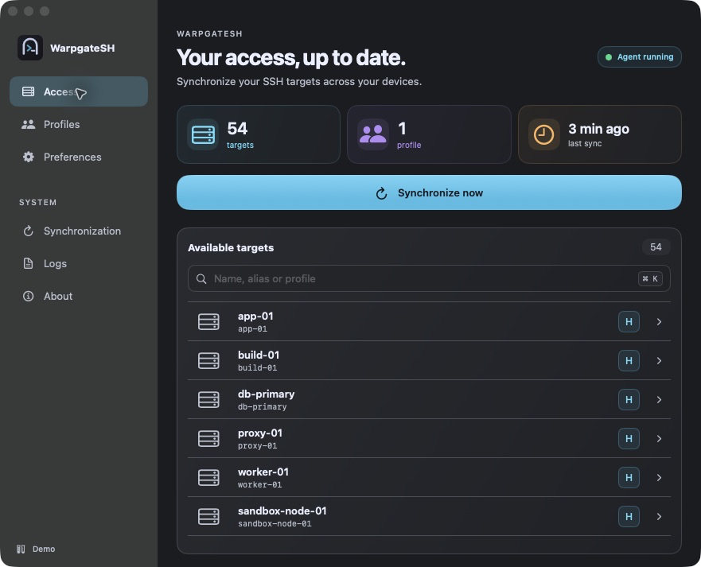
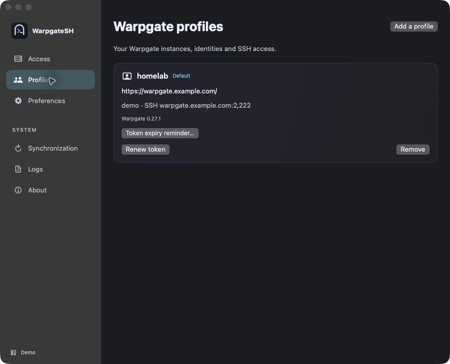
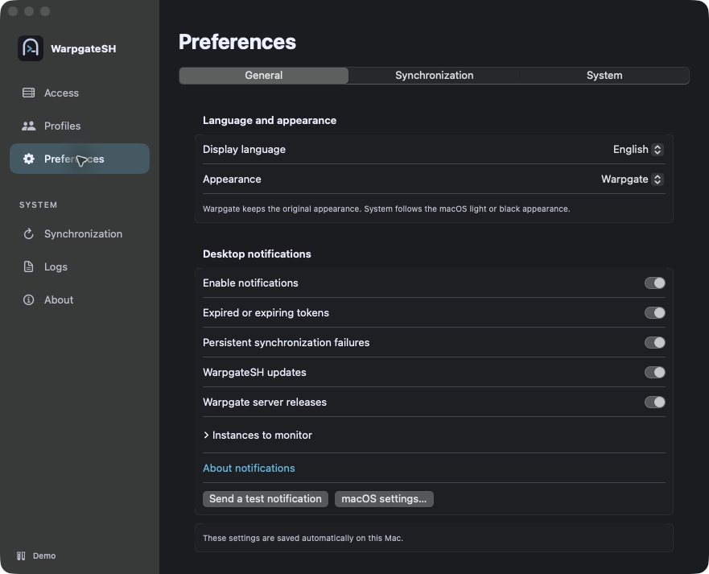
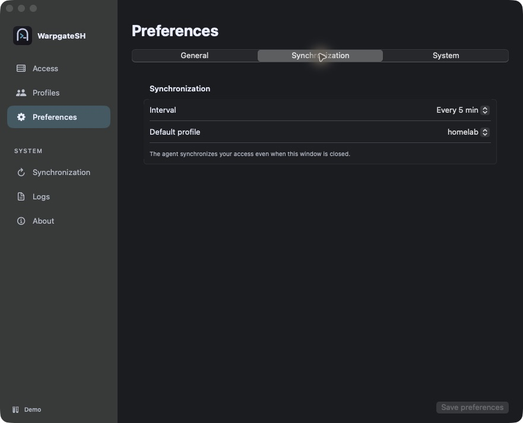
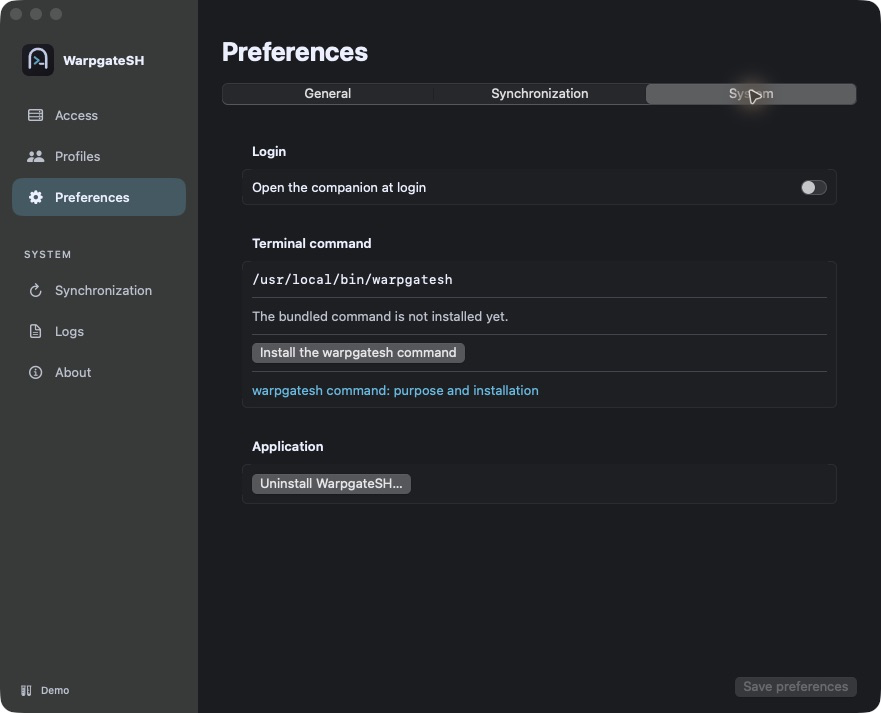
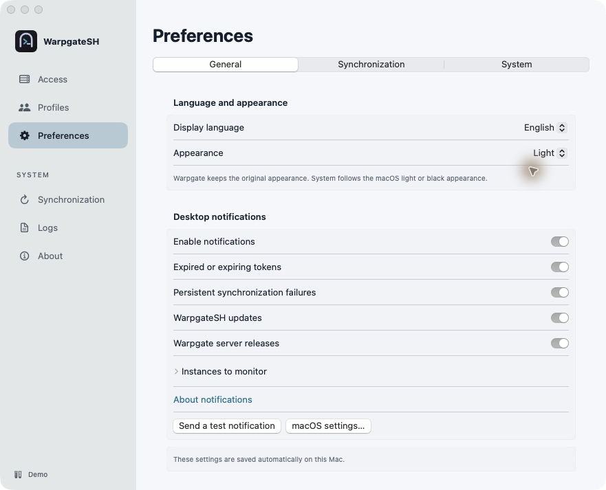
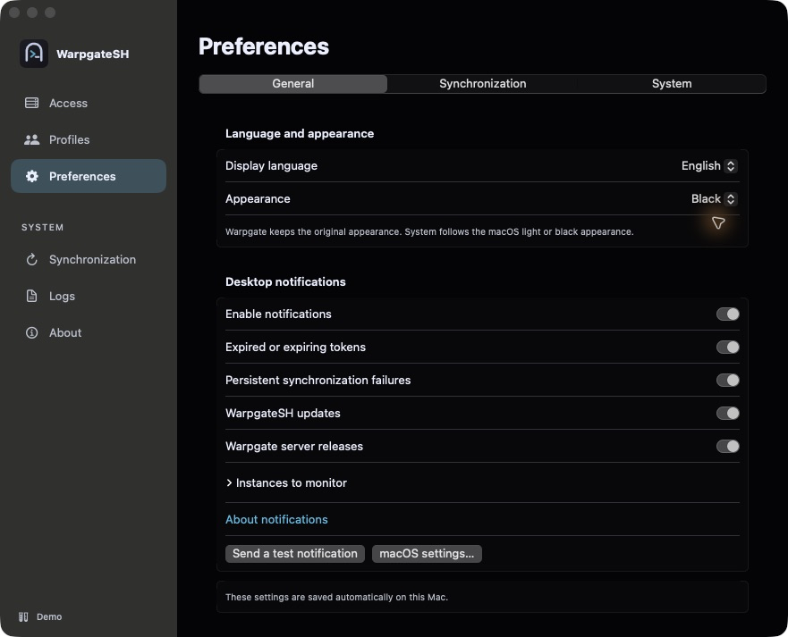
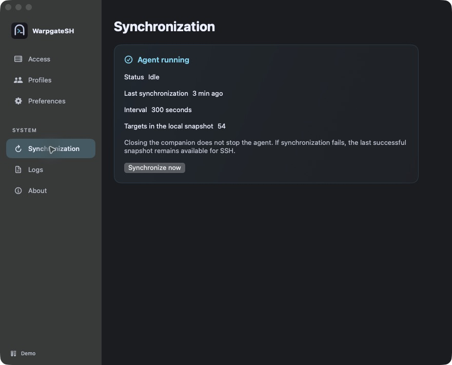
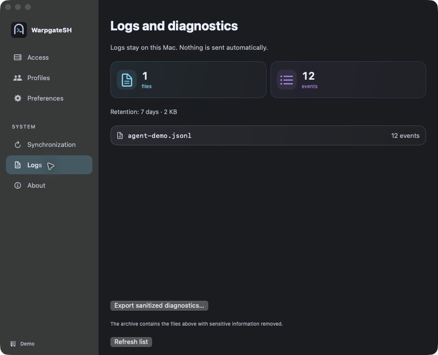
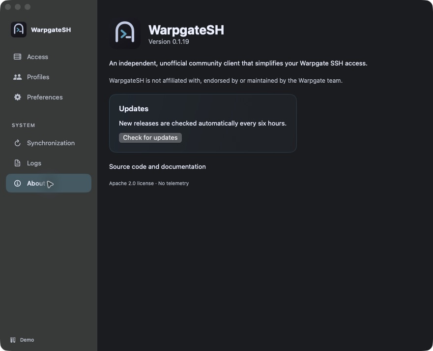

# Native macOS companion

The WarpgateSH companion uses SwiftUI with the sidebar, translucent macOS
material, application logo, and hover feedback shown below. It remains optional:
the synchronization agent and OpenSSH access work independently of its window.

**Availability:** the native interface is available in **v0.1.18 and later**.
The screenshots are actual captures of the running SwiftUI application in its
isolated demo mode. Every profile, target, counter and diagnostic entry shown
is fictional. These v0.1.19 captures use English labels. From v0.1.19 the
interface supports French, English and automatic language selection.

## Access

Check the agent state, synchronized target count, configured profiles, and the
age of the last successful synchronization. Use **Synchronize now**
for an immediate sync, or **⌘K** to search by name, alias or profile. Selecting
a target in the connected app opens its qualified alias in the terminal.
The last successful snapshot remains available if a later synchronization fails.

## Profiles

Use **Add a profile**, enter the local name, instance URL and personal API
token, then select **Check profile**. Compare the displayed SSH host-key
fingerprints with a trusted source. Enable **I verified these fingerprints through a trusted channel** and select **Save** only after they match.

**Options SSH** lets you override a detected hostname or port. If the keys change
between inspection and saving, enrollment is refused and must be verified again.
Existing profiles offer **Renew token**, **Set as default** and a
confirmed **Remove** action. Tokens stay in the platform secret store.

## Preferences

From **v0.1.19**, preferences have three tabs:

- **General**: choose Automatic, Français or English; select Warpgate, Light,
  Black or System appearance; configure [desktop notifications](#notifications).
  These local preferences save immediately. System follows macOS light/dark mode.
- **Synchronization**: set the synchronization interval and default profile.
- **System**: open at login, install the terminal command, read its guide or
  uninstall the application. Existing conflicting commands are preserved.

Select **Save preferences** to apply changes under Synchronization or System.
The independent agent continues working when the companion window is closed.

### Light and Black appearances

The original **Warpgate** theme remains the default. Light and Black provide
explicit alternatives; System switches between them with the macOS appearance.

## Synchronization

Inspect the agent state, configured interval, last successful snapshot and
synchronization alerts. Follow a profile-related alert to **Profiles** when a
token or SSH key requires attention. Closing the window leaves the agent running.

## Logs

Review the local file list, event counts, total size and seven-day retention
before selecting **Export sanitized diagnostics…**. Export creates a local
sanitized ZIP; it never uploads anything. Review the archive before sharing it.

## About

Check the installed version and update status. DMG installations check for new
releases every six hours; **Check for updates** requests a manual check.
An available signed update requires confirmation before replacing the app, CLI
and agent together. Homebrew installations instead show the upgrade command.
The version shown corresponds to the v0.1.19 source build used for these captures.

## Menu bar, keyboard and accessibility

The menu-bar companion shows agent status and counts and provides shortcuts to
the main window, synchronization, profiles and preferences. **⌘,** opens
Preferences; **Escape** dismisses sheets. Native controls have accessibility
labels, hover motion respects Reduce Motion, and the sidebar becomes opaque
when Reduce Transparency is enabled. Full assistive-technology coverage still
requires manual verification before publication.

## Run from source

See the [native companion development guide](../apps/warpgatesh-macos/README.md).
Its preview script starts in isolated demo mode by default. The public signed
DMG remains available from the [latest release](https://github.com/M0okz/warpgatesh/releases/latest).

## Notifications

**Availability:** desktop notifications are included from **v0.1.19**.

Open **Preferences → General → Desktop notifications** to enable macOS alerts.
macOS asks for permission the first time. If permission is denied, use **macOS
settings…** to change it. **Send a test notification** checks delivery.

You can choose which alerts to receive:

- **Expired or expiring tokens:** rejected authentication opens the profile list.
  For advance reminders, enter a known expiry date under **Profiles → Token expiry
  reminder…**. Reminders occur within seven days, within one day, and after expiry.
  WarpgateSH does not guess the date of an existing token. Successfully replacing
  the token clears its old reminder date.
- **Persistent synchronization failures:** an alert opens diagnostics when the
  agent reports repeated failures or overdue synchronization.
- **WarpgateSH updates:** an alert opens About when a client update is available.
- **Warpgate server releases:** optional checks compare each selected instance's
  observed version with the latest stable public Warpgate release. Use **Instances
  to monitor** to exclude profiles. Checks run every six hours and send no instance
  URL, username or token to GitHub. The notification opens the official release
  notes; it does not update the server.

An ongoing incident is notified once and becomes eligible again after recovery.
Each update is notified once per version. Notifications continue with the window
closed while WarpgateSH remains in the menu bar. Quitting the companion stops its
notifications; the independent synchronization agent continues running.

The interface is available in French and English. The same settings are under
**Préférences → Général → Notifications du bureau** in French.
