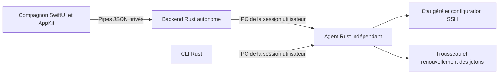

# Plan de retrait complet de Tauri de WarpgateSH

> **Exécution en cours — 1er novembre 2026.** Gregory a autorisé la migration
> complète, les tests et la publication. Ajustement approuvé : **Sparkle natif
> 2.10.1**, avec compatibilité de mise à jour depuis 0.1.24. Les sections
> historiques qui prévoyaient un installeur Rust sont remplacées par l’ADR 0038.
> Aucun installeur privilégié ou mécanisme de bascule maison n’est livré.
> Suivi : [issue #15](https://github.com/M0okz/warpgatesh/issues/15).

Date : 1 novembre 2026. Statut : plan prêt pour une exécution ultérieure.

Suivi de réalisation : **WarpgateSH #45**, à faire.

La version **0.1.24 est la base fonctionnelle confirmée par Gregory**, notamment
pour l’icône de barre des menus et l’identité des éléments de connexion. La
migration remplacera l’hôte Tauri et ses outils de distribution par un backend
Rust autonome et un assemblage macOS explicite, en conservant l’interface SwiftUI
validée et toutes les fonctions existantes.

L’exécution doit aller jusqu’à une livraison complète : une branche dédiée,
des commits relisibles, une PR de migration et une release après validation.
Les étapes ci-dessous sont des jalons internes ; le prototype ou le seul retrait
des dépendances ne constituent pas la fin du travail. La demande actuelle porte
sur la préparation de cette note ; l’implémentation n’est pas commencée.

## Périmètre

**Inclus** : backend, protocole privé, ouverture à la connexion, cycle de vie,
mises à jour signées, packaging universel, signature Apple, notarisation,
installation CLI, désinstallation, tests, Nix, CI, documentation, captures,
GitHub, Homebrew et site public.

**Conservés** : macOS 13 minimum, Apple Silicon et Intel, SwiftUI et AppKit,
les six écrans, le logo et son échelle dans le Dock, FR/EN/automatique, les thèmes
Warpgate/clair/noir/système, les notifications, la connexion WebKit à Warpgate,
la CLI et l’agent Rust indépendant. Les profils, les jetons, leur renouvellement,
les choix utilisateur et les fichiers SSH gardent leurs formats et emplacements.

**Hors périmètre** : réécrire le métier Rust en Swift, ajouter une interface
Linux ou Windows, refaire le design, changer les politiques d’authentification,
faire tourner les clés de signature ou migrer le stockage des secrets.
Le site peut conserver Node.js ; sa chaîne de build est distincte de celle de
l’application macOS.

## Point de départ vérifiable

Reprendre le dépôt à jour et comparer son état avec la release
[v0.1.24](https://github.com/M0okz/warpgatesh/releases/tag/v0.1.24).
Au moment de la préparation, `main` est sur
`f08d9df1b97016a4ccc42e969939175fffc7cb74` ; il inclut la correction des outils
de signature utilisée pour reconstruire le tag immuable de la 0.1.24.

- `apps/warpgatesh-macos` porte déjà les fenêtres, la barre des menus,
  l’authentification WebKit et les notifications natives.
- `apps/warpgatesh-companion/src-tauri/src/native.rs` démarre encore un hôte
  Tauri sans fenêtre ni WebView. SwiftUI lui parle par pipes privés.
- `commands.rs`, `updates.rs` et `relaunch.rs` utilisent encore `AppHandle`,
  l’état global Tauri, son exécuteur async ou ses plugins.
- Le frontend React/Vite demeure un repli de développement. Il n’est pas
  l’interface macOS de production.
- Nix et GitHub Actions appellent encore le bundler et le signer Tauri.

Les décisions existantes à préserver sont les ADR
[0016](adr/0016-make-the-agent-the-single-local-writer.md),
[0023](adr/0023-update-the-complete-product-with-user-consent.md),
[0036](adr/0036-use-swiftui-for-the-macos-companion.md) et
[0037](adr/0037-manage-personal-api-tokens-through-the-agent.md).
Une nouvelle ADR remplacera la décision Tauri de l’ADR 0015 et la transition
temporaire décrite dans l’ADR 0036, sans effacer leur historique.

## Architecture cible

Ce schéma représente le chemin des mutations métier. Les lectures d’état et
les réglages de présentation locaux conservent leurs responsabilités actuelles.
L’agent reste l’unique écrivain des profils, jetons et fichiers SSH gérés.

La séparation en couches est adaptée à la frontière remplacée : les services
Rust ne dépendent plus d’un framework d’interface. La présentation conserve
son organisation MVVM actuelle, `CompanionModel`, `ObservableObject` et
`CompanionTransport`, compatibles avec macOS 13. Aucun nouveau framework de
présentation ni passage à une API réservée à un macOS plus récent n’est prévu.

Créer `crates/warpgatesh-companion` dans le workspace commun, avec une bibliothèque
testable et le binaire **`warpgatesh-companion`**. Il remplace le backend actuel
au même emplacement dans le bundle. Conserver les arguments internes
`--native-backend --native-parent` et un petit mode lanceur sans ces arguments
pour les anciens éléments de connexion qui ciblent encore ce binaire.

Le point d’entrée de l’application reste **`warpgatesh-ui`**. Un contexte explicite
fournit au backend la version, le bundle installé, les ressources et le parent
SwiftUI. Les dépendances de mise à jour, d’ouverture de session et de terminaison
sont injectées ; elles ne passent plus par `AppHandle` ou un singleton Tauri.
Tokio remplace l’exécuteur Tauri, avec une version compatible avec le Rust épinglé.

Conserver le protocole de mise à jour actuel facilite la transition depuis les
clients installés. Ce choix transfère au projet la maintenance du moteur
d’installation et de reprise fourni jusqu’ici par le plugin. Ses tests de
signature, d’extraction, de remplacement et de récupération font donc partie
du travail de retrait, avec une revue spécifique avant livraison.

## Matrice de remplacement

| Élément actuel | Cible et résultat attendu |
| --- | --- |
| `src-tauri/src/native.rs` | Serveur JSON-lines autonome, arrêt sur EOF, limites et corrélation conservées |
| `commands.rs` | Opérations Rust réutilisées avec contexte et services explicites, sans macros Tauri |
| `agent_setup.rs` et `installation.rs` | Comportements existants transférés ; installation, mode manuel, CLI et désinstallation préservés |
| `companion_login.rs` et plugin autostart | Contrôleur autonome de lecture, activation et retrait des seuls éléments appartenant à WarpgateSH |
| `updates.rs` et plugin updater | Vérification du flux actuel, téléchargement et installation signés autonomes |
| `relaunch.rs` | Relance indépendante après sortie effective de l’ancienne interface et du backend |
| `lib.rs`, `main.rs`, `tray_menu.rs` Tauri | Hôte, événements et menu historiques retirés ; SwiftUI/AppKit restent propriétaires du cycle de vie |
| `tauri.conf.json` | Métadonnées non secrètes sous `apps/warpgatesh-macos/Bundle/`, version lue depuis le workspace et clé publique conservée |
| Icônes, ressources et scripts sous `apps/warpgatesh-companion` | Ressources utiles transférées avant suppression du dossier historique |
| Bundler et signer CLI Tauri | Scripts Nix/Python/outils Apple et outil Rust de signature de distribution autonome |
| React, Vite, TypeScript et dépendances Tauri | Retirés de la chaîne application ; dépendances du site conservées selon leur usage |

## Exécution en dix étapes

Prévoir dès le départ une session graphique déverrouillée, les environnements
macOS minimum/Intel et Apple Silicon, les accès GitHub/CI/site et les clés de
distribution existantes par leur mécanisme sécurisé habituel. Les tests qui
créent ou retirent des jetons utilisent une instance et des profils de test
autorisés ; les dialogues SSO/MFA restent ceux de l’instance. La disponibilité
de ces moyens se vérifie avant d’engager les étapes qui en dépendent.

### Étape 1 Figer la référence et les preuves

- [ ] Vérifier Git, les instructions locales, les versions disponibles et les
  travaux non liés ; créer une branche `codex/` et l’issue GitHub d’architecture.
  Relier l’issue à cette note et au suivi Vikunja.
- [ ] Conserver la distribution officielle 0.1.24 comme référence réinstallable.
  Utiliser un compte macOS ou des fixtures jetables pour les parcours destructifs.
- [ ] Relever sur la même machine et avec les mêmes données de démo la taille
  du bundle/DMG, le lancement jusqu’à la fenêtre et à l’icône, la mémoire et le
  CPU au repos des processus UI/backend, et la durée d’un build propre puis
  incrémental. Faire plusieurs mesures et conserver médiane et dispersion.
- [ ] Ajouter l’ADR de remplacement et une matrice fonctionnelle avant/après.
  Les gains de taille et de performance seront mesurés, sans pourcentage promis.

### Étape 2 Extraire le backend et verrouiller le protocole

- [ ] Porter les opérations et leurs tests dans le nouveau crate, puis injecter
  les services de plateforme et d’update. Remplacer les imports/macros Tauri,
  l’état `app.state`, les émissions d’événements et l’exécuteur async.
- [ ] Garder les noms de commandes, formes JSON et erreurs attendus par Swift,
  ainsi que `CompanionTransport` et `DemoBridge`. Couvrir la sérialisation
  `snake_case`/`camelCase` et l’événement explicite `exit` utilisé lors d’une
  relance/désinstallation par des fixtures de contrat partagées. Une déconnexion
  inattendue du backend reste une erreur récupérable dans l’interface.
- [ ] Conserver les pipes hérités sans port d’écoute supplémentaire, les
  requêtes limitées à 64 Kio, au plus seize opérations simultanées et les
  réponses corrélées. Réserver stdout au protocole ; nettoyer les diagnostics.
- [ ] Tester requêtes invalides, saturation, EOF, parent disparu, backend arrêté,
  réponse tardive et demandes concurrentes. Préserver délais, annulation et
  protection contre une lecture obsolète ; ne pas rejouer automatiquement une
  mutation après une réponse perdue. Arrêter les tâches de fond du backend
  sans terminer l’agent indépendant.

### Étape 3 Remplacer les intégrations Tauri et préserver les choix macOS

- [ ] Compléter `companion_login` avec les opérations auparavant fournies par
  autostart. Préserver les deux labels et leurs chemins : `WarpgateSH.plist`
  et `dev.warpgatesh.agent.plist`, chacun associé au bundle.
- [ ] Préserver les arguments et les états activé/désactivé. Une migration au
  démarrage ne crée pas d’élément absent, ne réactive pas un service refusé par
  macOS et ne modifie pas un fichier appartenant à une autre installation.
- [ ] Garder `dev.warpgatesh.companion`, les identifiants Trousseau, les domaines
  UserDefaults, le Team ID de distribution et les chemins de données. Vérifier
  l’accès aux secrets existants sans effacer les autorisations système.
- [ ] Conserver le premier lancement explicatif uniquement pour une installation
  qui en a besoin, le choix « Plus tard », la synchronisation manuelle et
  l’activation ultérieure. Un agent déjà actif ne revoit pas cette demande.
- [ ] Rebrancher installation de la CLI, ouverture du terminal/des liens,
  diagnostics et désinstallation avec leurs confirmations existantes.
  Quitter le compagnon conserve l’agent. La désinstallation du produit retire
  ses composants selon les choix et confirmations existants.

### Étape 4 Remplacer complètement les mises à jour Tauri

- [ ] Garder le flux public `releases/latest/download/latest.json`, ses champs
  `version`, `notes`, `pub_date`, `platforms`, `url`, `signature`, et les deux
  cibles `darwin-aarch64`/`darwin-x86_64`. Garder les noms
  `WarpgateSH.app.tar.gz` et `.sig`, la clé publique et le couple de clés
  existants. La compatibilité du format ne nécessite pas la bibliothèque Tauri.
- [ ] Créer un outil Rust de signature de distribution autonome, fondé sur
  Minisign et épinglé dans le build. Vérifier le format de clé chiffrée, de
  signature et leur encodage avec le vérificateur de la 0.1.24. Les noms actuels
  des secrets CI peuvent servir d’alias de compatibilité ; aucune clé n’est
  régénérée ou exportée dans les logs pour cette migration.
- [ ] Préserver SemVer, le cache de contrôle de six heures, la vérification
  manuelle forcée, les notes et les états/progressions déjà consommés par Swift.
  Une notification ou un contrôle de version ne déclenche pas une installation.
  Le canal Homebrew reste géré par Homebrew et une app sur DMG reste non éligible.
- [ ] Télécharger par HTTPS, sans identifiants Warpgate, avec délais et bornes
  de taille. Vérifier la signature Minisign avant toute extraction. Rejeter
  manifeste incohérent, cible incompatible, archive tronquée, signature absente
  ou erronée et version plus ancienne ou déjà installée.
- [ ] Extraire en privé avec limites de taille décompressée/nombre de fichiers.
  Refuser traversées de chemin, chemins absolus, liens qui sortent du bundle,
  fichiers spéciaux et contenu inattendu. Valider version, bundle ID,
  `CFBundleExecutable`, architectures, signature Apple et Team ID attendus.
  Les contrôles côté client utilisent les API/outils livrés avec macOS ;
  ils n’exigent pas Xcode, Nix ou Node sur le poste utilisateur.
- [ ] Implémenter une transaction de remplacement testable : verrou exclusif,
  staging sur le volume de destination, état de reprise durable, ancienne app
  conservée jusqu’au succès, gestion de l’espace et des permissions, relance
  d’un helper vérifié hors du bundle remplacé. Celui-ci attend la sortie
  effective des anciens processus et remplace l’application complète, pas
  seulement l’exécutable SwiftUI.
- [ ] Interrompre l’agent uniquement pour la bascule finale et seulement s’il
  était actif ; le redémarrer depuis le nouveau bundle. Préserver le mode
  manuel. Programmer la réouverture après remplacement sans prendre un PID
  Launch Services invalide ou un ancien processus pour la nouvelle instance.
- [ ] Tester échecs et interruptions à chaque étape, y compris permissions
  refusées, réseau coupé, manque d’espace, remplacement partiel et relance en
  échec. Couvrir les chemins avec espaces, apostrophes et métacaractères ;
  transmettre les arguments littéralement, sans les interpoler en code shell.
  Avant la validation du nouveau lancement, restaurer l’ancienne app
  et l’état précédent de l’agent, ou exposer une reprise explicite sans perdre
  les données. Après validation, supprimer uniquement les temporaires et la
  copie de retour arrière créés par l’opération.

### Étape 5 Verrouiller la compatibilité de la première mise à niveau

- [ ] Tester **updater épinglé sur la 0.1.24 → candidat sans Tauri** dans un banc
  isolé. Injecter le serveur de test dans la fixture, sans modifier l’application
  officielle installée ni détourner son HTTPS. Distinguer cette preuve de
  compatibilité du test avec la vraie 0.1.24 publiée, prévu à l’étape 10.
- [ ] Tester **candidat sans Tauri → version de test suivante**, via le nouveau
  moteur complet. Les deux transitions doivent télécharger, vérifier, remplacer
  UI/backend/CLI/agent, puis rouvrir la bonne version.
- [ ] Vérifier profils existants, entrée Trousseau, état SSH, langues/thèmes,
  notifications et choix de démarrage avant/après. Inclure une installation en
  mode manuel et une avec agent actif. Aucun réenrôlement n’est requis par le
  changement d’architecture.
- [ ] Garder le retour manuel au DMG de référence possible. Une panne du nouveau
  moteur après une bascule validée ne justifie pas un downgrade automatique
  non consenti ni une perte de données. Ne pas publier de version intermédiaire
  nécessitant encore Tauri.

### Étape 6 Assembler et signer le bundle sans outils Tauri

- [ ] Créer le packaging sous `apps/warpgatesh-macos/`, avec métadonnées et icônes
  sous `Bundle/` et scripts sous `scripts/`. La version du workspace est la
  source de référence, y compris pour la version de démo ; la clé publique
  d’update est embarquée sans secret dans les ressources/configurations utiles.
- [ ] Compiler Swift et Rust pour `arm64` et `x86_64`, assembler les quatre
  exécutables et les ressources Swift. Garder `warpgatesh-ui` comme exécutable
  principal et son identité de signature égale à l’identifiant du bundle.
- [ ] Signer explicitement les composants imbriqués puis l’app, avec Hardened
  Runtime et horodatage. Notariser et agrafer l’app finale, puis fabriquer le
  DMG et l’archive d’update depuis cette même app. Signer l’archive avec l’outil
  autonome, puis signer/notariser/agrafer le DMG et produire son SHA-256.
- [ ] Vérifier aussi le contenu extrait du DMG et de l’archive : signature,
  Gatekeeper, tickets, architectures, minimum macOS et absence de dépendance
  à `/nix/store`. Déplacer les vérificateurs existants hors du dossier historique.
  L’app installée fonctionne sur un Mac sans outils de développement.

### Étape 7 Aligner Nix et tous les contrôles CI

- [ ] Conserver `nix run .#check`, `.#build-macos`, `.#release-macos` et
  `.#build-site` comme entrées de référence. Le build macOS ne lance plus
  npm/Vite, Tauri CLI, `tauri-build` ou un script encore situé sous `src-tauri`.
- [ ] Unifier les crates et le verrou Cargo, adapter les filtres de sources et
  les sélections de paquets Nix/Homebrew. Les outils de signature de release et
  le compagnon macOS ne deviennent pas des exécutables installés avec la CLI
  Linux. Protéger les adaptateurs macOS par les configurations de cible utiles.
- [ ] Porter tests de contrat, manifestes, distribution, relance et installation
  vers les nouveaux emplacements. Ajouter les scénarios d’update et d’intégrité
  ci-dessus ; garder les tests métier CLI/agent sur Linux et macOS.
- [ ] Aligner `.github/workflows/ci.yml`, `release-macos.yml`, les scripts de
  sélection Xcode, les caches, les artefacts et les chemins de récupération.
  Le workflow normal et la reconstruction manuelle d’un tag utilisent le même
  packaging autonome. Un tag signé existant n’est jamais déplacé.

### Étape 8 Retirer les composants obsolètes après validation de la parité

- [ ] Retirer `apps/warpgatesh-companion` après transfert des opérations, tests,
  ressources et outils utiles. Retirer React/Vite/TypeScript, les plugins,
  configurations, capacités, `build.rs` Tauri et verrous devenus inutiles.
- [ ] Examiner `apps/warpgatesh-macos-demo` et conserver ses éléments encore
  utiles avant retrait des seuls prototypes devenus obsolètes. Préserver les
  captures et documents historiques correctement identifiés.
- [ ] Vérifier `cargo tree`, les manifestes npm de l’app, les scripts actifs et
  le contenu du bundle : aucune dépendance `tauri*`, `tao`, `wry`, aucun frontend
  Tauri embarqué, aucun appel au bundler ou au signer Tauri. Le nom historique
  d’un secret CI ou une mention dans un changelog n’est pas une dépendance.
- [ ] Conserver WebKit pour la connexion native à l’instance et ses protections
  d’origine, de cookie, SSO/MFA et de TLS. Refaire les mesures de l’étape 1 dans
  les mêmes conditions et documenter les gains réellement observés.

### Étape 9 Valider le comportement utilisateur sur des installations représentatives

- [ ] Exécuter la matrice ci-dessous sur un bundle empaqueté. Tester une session
  macOS neuve et une identité de test neuve : l’enregistrement déjà présent
  sur le Mac de développement ne prouve pas le fonctionnement d’une installation
  neuve. Inclure le minimum macOS 13, Intel et un macOS actuel sur Apple Silicon.
- [ ] Vérifier visuellement l’icône avant/après la croix rouge, la réouverture,
  ⌘Q, l’ouverture à la connexion et le nom dans les réglages macOS. Un processus
  vivant ou une entrée de permission ne remplace pas le contrôle de l’icône.
- [ ] Vérifier VoiceOver, navigation clavier, focus des fenêtres/dialogues,
  libellés FR/EN, Réduire les animations et Réduire la transparence. Garder les
  contrôles natifs et les préférences d’accessibilité existantes.
- [ ] Réserver ajouts, renouvellements, révocations, suppressions et
  désinstallation aux comptes/profils/instances de test prévus pour ces actions.
  Ne pas utiliser les données personnelles comme fixtures destructibles.

### Étape 10 Livrer et clôturer la migration

- [ ] Exécuter les contrôles de référence, la CI et les essais de mise à niveau
  signée ; choisir la prochaine version libre supérieure à 0.1.24 et aligner
  workspace, bundle, démo, changelog, manifeste et notes de release.
- [ ] Mettre à jour README, CONTRIBUTING, guides Nix/macOS/Linux concernés,
  installation, dépannage, désinstallation et ADR. Corriger les références aux
  anciens chemins et au repli Tauri ; conserver l’historique des versions.
- [ ] Capturer les écrans réellement modifiés/versionnés en démo avec données
  fictives. Contrôler rendu, format, dimensions et empreintes ; identifier
  honnêtement les captures anciennes conservées car l’écran est inchangé.
- [ ] Fusionner la PR après les contrôles, publier le tag signé et préparer le
  brouillon de release avec DMG, SHA-256, archive, signature et `latest.json`.
  Valider les fichiers téléchargés et une installation réelle avant publication.
- [ ] Publier la release et Homebrew avec le bon SHA-256. Déployer le site sur
  l’hébergement existant après revalidation de sa cible, puis comparer son
  contenu à l’artefact CI et vérifier les pages/captures publiques et privées.
- [ ] Vérifier immédiatement la mise à jour depuis la **0.1.24 officielle signée**
  via le flux public, dans l’environnement isolé. En cas d’échec de distribution,
  rétablir l’ancienne proposition publique d’update/version stable et publier
  un correctif supérieur si nécessaire ; conserver les tags et données et ne
  pas forcer de downgrade sur les postes déjà migrés. Le suivi reste ouvert
  jusqu’à la réussite de ce contrôle.
- [ ] Nettoyer les fixtures, téléchargements, montages et seules copies créés
  pour la migration après validation ; conserver les preuves utiles et les
  sauvegardes préexistantes. Relancer l’app en mode réel, vérifier l’agent et
  la dernière synchronisation, puis clôturer le suivi avec liens de livraison.

## Matrice de parité fonctionnelle

Toutes les commandes ci-dessous doivent rester couvertes ; leur succès,
leurs erreurs et leurs effets comptent, pas seulement leur présence dans un enum.

| Parcours | Commandes ou contrôles à préserver |
| --- | --- |
| Démarrage et état | `initialize`, `get_companion_state` ; agent actif ou absent, premier lancement, états vides et erreurs |
| Synchronisation | `set_background_agent`, `sync_now` ; mode manuel, sortie du compagnon, reprise et instantané conservé sur échec |
| Préférences | `save_preferences` ; intervalle, profil par défaut, ouverture à la connexion ; présentation FR/EN/auto et quatre apparences |
| Enrôlement | `open_token_page_for`, `inspect_profile`, `add_profile` ; URL, identité, approbation puis rescan des empreintes SSH |
| Jetons et profils | `renew_profile_token`, `rotate_profile_token`, `set_token_auto_renew`, `remove_profile` ; propriété des jetons, échéances et reprise sur erreur |
| Connexion SSH | `open_target` ; alias qualifié, terminal, échappement et comportement CLI/OpenSSH inchangés |
| Diagnostics | `preview_diagnostics`, `export_diagnostics` ; export explicite nettoyé, conservation et absence de secrets |
| Installation et retrait | `install_command_line_tool`, `uninstall_warpgatesh` ; liens existants, permissions, confirmation et conservation/suppression choisie des données |
| Mise à jour | `check_for_updates`, `install_update` ; contrôle manuel/périodique, signature, installation, retour arrière et relance |
| Fonctions natives | Barre des menus, Dock, fenêtre unique, liens visibles, thèmes, notifications de jetons/sync/versions et navigation depuis une notification |
| Démo | `--demo`, `--demo-first-launch` ; aucun backend réel, accès secret, appel réseau, changement SSH ou installation d’agent |
| Portabilité | CLI, agent, alias/zsh et tests Linux ; architectures et minimum macOS réellement vérifiés |

## Critères de fin

- [ ] Le bundle et toute sa chaîne de construction/distribution fonctionnent
  sans Tauri ; le backend n’a plus d’hôte GUI ni de dépendance au frontend web.
- [ ] La matrice de parité est validée et les deux transitions d’update signée
  sont démontrées : 0.1.24 → version sans Tauri → version de test suivante.
- [ ] Une installation neuve et une installation existante conservent une
  fenêtre/une icône correctes, les choix de démarrage, le nom de l’application,
  les profils et l’accès aux secrets. Les écrans et actions restent accessibles.
- [ ] Le domaine métier et les mutations restent dans Rust et dans l’agent ;
  les vues n’embarquent ni API Warpgate dupliquée ni stockage de jetons.
- [ ] Les tâches async ont des délais, une annulation et une gestion explicite
  des erreurs ; les tests utilisent des services injectés et des fixtures isolées.
- [ ] Nix, CI, macOS 13/Intel/Apple Silicon, Linux et la distribution Apple sont
  validés. Une limite de banc de test ou un contrôle rouge reste explicite et
  empêche de déclarer la migration complètement livrée.
- [ ] GitHub, Homebrew, le site et ses captures correspondent à la version
  publiée ; les preuves identifient version, commit et périmètre réel des tests.
- [ ] Les mesures avant/après sont consignées ; aucune amélioration chiffrée
  n’est annoncée sans mesure. Les temporaires sont nettoyés et le suivi est clos.

## Références techniques

Le format d’archive et de manifeste à conserver est décrit dans la
[documentation officielle de l’updater Tauri](https://v2.tauri.app/plugin/updater/).
Cette référence sert à garantir la compatibilité des clients existants ; elle
n’impose pas de conserver Tauri dans la nouvelle implémentation.

L’association des anciens LaunchAgents à l’app doit préserver les exigences de
bundle et de Team ID décrites par
[Apple Service Management](https://developer.apple.com/documentation/servicemanagement/updating-helper-executables-from-earlier-versions-of-macos).
Le flux de distribution reste soumis à la signature Developer ID et à la
[notarisation Apple](https://developer.apple.com/documentation/security/notarizing-macos-software-before-distribution).

Les commandes de référence restent décrites dans le
[guide Nix](development-nix.md) et la
[procédure de release macOS](releasing-macos.md), à aligner pendant l’exécution.
